# NEXVIA

> O alerta avisa. O bairro garante que ninguém fique para trás.

App mobile em Flutter e Dart da Global Solution FIAP 2026.2, feito para a disciplina de Flutter. O nome junta **nexo**, a ligação entre vizinhos, com **via**, a rua do bairro. A faixa amarela tracejada do logo é a faixa da rua.

## Desenvolvedores — Equipe RiskLess

| Nome completo | RM |
| --- | --- |
| Arthur Paixão | 551739 |
| Vinicius Fagundes da Silva | 555270 |

**Repositório:** https://github.com/ArthurPaixao/NEXVIA-Flutter

<p>
  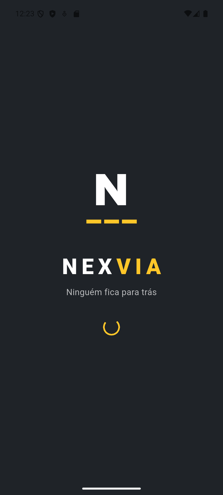
  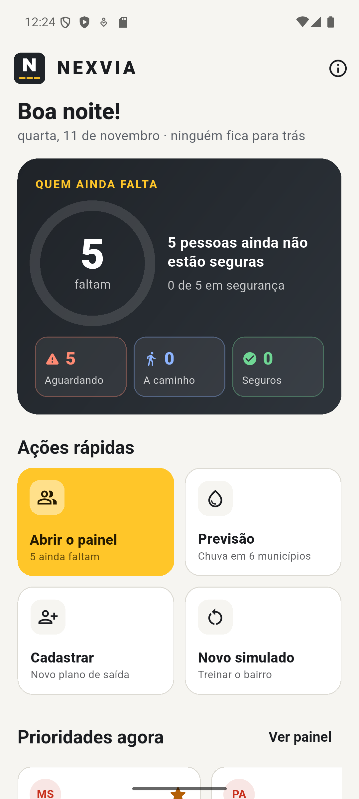
  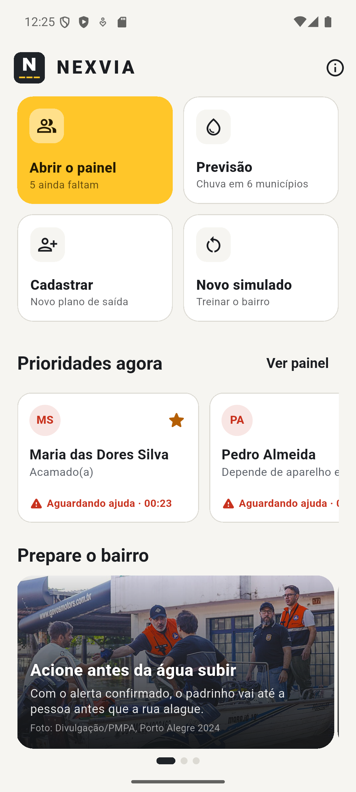
  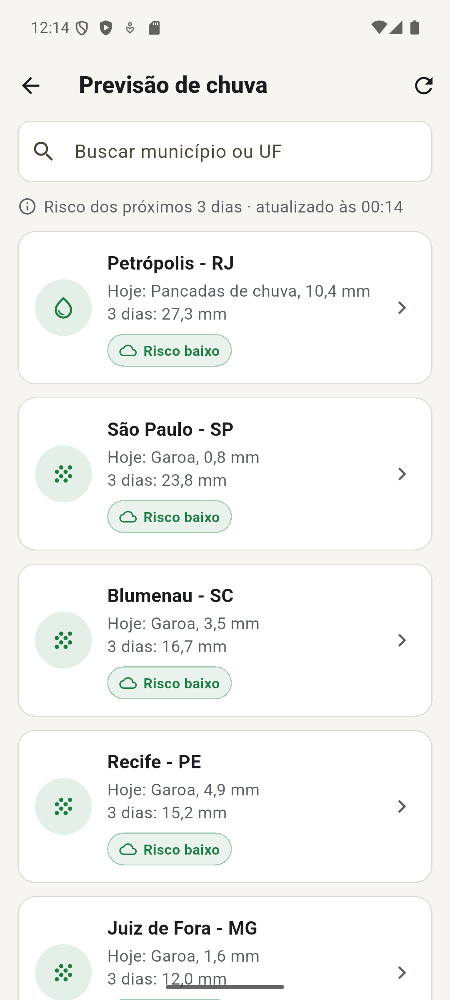
</p>

## Tema da Global Solution

Eventos climáticos extremos e proteção de pessoas vulneráveis. O alerta da Defesa Civil chega ao celular de quem está na área de risco, mas para aí: ninguém fica sabendo quem conseguiu sair de casa. Quem mais sofre é quem não consegue sair sozinho: pessoas acamadas, idosos que moram sozinhos, pessoas com deficiência e quem depende de aparelho elétrico, como um concentrador de oxigênio.

- O IBGE contou 8,27 milhões de pessoas em áreas de risco nos 872 municípios monitorados (Censo 2010). [Fonte](https://agenciadenoticias.ibge.gov.br/agencia-sala-de-imprensa/21565-em-2010-brasil-tinha-8-3-milhoes-de-pessoas-morando-em-areas-com-risco-de-desastres-naturais.html)
- Na enchente do RS em 2024, o alerta chegou a toda a população em só 42,9% das cidades atingidas. [Fonte](https://agenciabrasil.ebc.com.br/meio-ambiente/noticia/2025-10/em-2024-alertas-chegaram-toda-populacao-em-429-do-rs)

**ODS:** 11 (meta 11.5), 13 (meta 13.1), 10 (meta 10.2) e 3 (meta 3.d).

## Descrição da solução

Cada pessoa vulnerável tem um **plano de saída**: um padrinho (vizinho ou familiar) que vai buscá-la, um padrinho reserva, um destino seguro e observações sobre o que levar.

O app junta duas frentes:

1. **Previsão de chuva:** consome uma API REST pública e mostra o risco de chuva forte nos próximos 3 dias em 6 municípios com histórico de enchentes e deslizamentos.
2. **Painel "Quem ainda falta":** na hora do alerta (ou de um simulado), o coordenador acompanha cada pessoa em três etapas: **Aguardando ajuda → Padrinho a caminho → Em segurança**. O número grande da tela inicial mostra quantas pessoas ainda faltam; o objetivo é levá-lo a zero.

O coordenador também cadastra, edita e exclui pessoas. O cadastro exige o consentimento da pessoa ou do responsável (LGPD).

**Importante:** é um protótipo acadêmico em modo simulado. Não envia SMS e não tem integração com a Defesa Civil. As 5 pessoas de exemplo são fictícias, e tudo fica salvo só no aparelho.

### A tela inicial

A tela inicial é um painel de comando com cinco blocos, montados com os componentes trabalhados nos tutoriais da disciplina:

| Bloco | Componente | O que mostra |
| --- | --- | --- |
| Saudação | `Text` + `DateTime` | "Boa noite!" de acordo com a hora, e a data por extenso |
| Quem ainda falta | `Stack` + `CircularProgressIndicator` (anel animado) | Quantas pessoas faltam no centro do anel, que se completa conforme as pessoas ficam seguras, e um resumo das três etapas |
| Ações rápidas | `GridView.count` com `AtalhoCard` | Abrir o painel, Previsão, Cadastrar e Novo simulado |
| Prioridades agora | `ListView` horizontal (`scrollDirection: Axis.horizontal`) | Pessoas prioritárias que ainda não estão seguras; um toque abre o detalhe |
| Prepare o bairro | `PageView` + `Image.network` (carrossel) | Dicas de preparo com fotos da internet. Avança sozinho a cada 6 s, tem indicador de página, `loadingBuilder` enquanto baixa e `errorBuilder` sem internet |

### Diferenciais

- **Busca que ignora acentos:** "sao paulo" encontra São Paulo; "antonio" encontra Antônio.
- **Animações:** o logo "voa" da Splash para a barra do Início (`Hero`); o número e o anel do contador animam quando alguém fica seguro (`TweenAnimationBuilder`); o carrossel avança sozinho (`Timer` + `PageController`).
- **Acessibilidade:** texto maior que o padrão, botões com no mínimo 48 dp de altura e a situação nunca indicada só pela cor (sempre com ícone e texto).
- **Validação com regra de negócio fora da tela:** `PessoaValidator` exige telefone com DDD, idade válida e consentimento.
- **Splash nativa e ícone do app** com a identidade do NEXVIA (asfalto + faixa amarela).
- **23 testes automatizados**, incluindo testes do WebService com `MockClient`, sem depender da internet.

## Fluxo de telas

```
Splash ──(SharedPreferences: "não mostrar a introdução"?)──┬── sim ──> Início
                                                           └── não ──> Introdução (3 páginas) ──> Início

Início ──(card de prioridade)──> Detalhes da pessoa
       ──(Cadastrar)──> Novo cadastro
       ──> Painel "Quem ainda falta" ──(toque no card)──> Detalhes da pessoa ──> Editar cadastro
                                     └──(Cadastrar)─────> Novo cadastro          └─> Excluir (confirmação)
       ──> Previsão de chuva ──(toque no card)──> Previsão do município (7 dias)
       ──> Sobre
```

São **7 telas principais**, além da Splash e da Introdução:

| Tela | Arquivo | O que faz |
| --- | --- | --- |
| Splash | `splash_screen.dart` | Mostra o logo, lê o SharedPreferences e decide entre Introdução e Início |
| Introdução | `onboarding_screen.dart` | 3 páginas com ícone, título e descrição; botões Voltar, Avançar e Pular; opção "Não mostrar novamente" |
| Início | `home_screen.dart` | Saudação, anel de quem ainda falta, grade de ações, prioridades na horizontal e carrossel com fotos |
| Painel | `painel_screen.dart` | Lista com busca, filtros, prioridade (★), ação rápida e botão Cadastrar |
| Detalhes da pessoa | `pessoa_detalhe_screen.dart` | Recebe a `Pessoa` por parâmetro; linha do tempo, plano de saída, próxima etapa, editar e excluir |
| Cadastro / Edição | `pessoa_form_screen.dart` | Mesmo formulário para criar (sem parâmetro) e editar (recebe a `Pessoa`); devolve a pessoa salva |
| Previsão de chuva | `previsao_screen.dart` | Consome a API com os estados inicial, carregando, sucesso e erro; busca por município |
| Previsão do município | `previsao_detalhe_screen.dart` | Recebe a `PrevisaoLocal` por parâmetro e mostra os 7 dias |
| Sobre | `sobre_screen.dart` | Problema, equipe, ODS e aviso de protótipo |

**Navegação:** `Navigator.push` com `MaterialPageRoute`. A Splash e a Introdução usam `pushReplacement`, para o botão Voltar não retornar a elas. As telas também **devolvem resultados** com `Navigator.pop`: o formulário devolve a `Pessoa` salva, e o Detalhe devolve `true` quando a pessoa foi excluída. Ao voltar, a tela anterior recarrega e mostra uma mensagem.

## Prints das telas

Capturas do app rodando no emulador (Pixel 8, Android 15), com a API real.

### Splash e Introdução

| Splash | Introdução 1 | Introdução 2 | Introdução 3 |
| --- | --- | --- | --- |
|  | 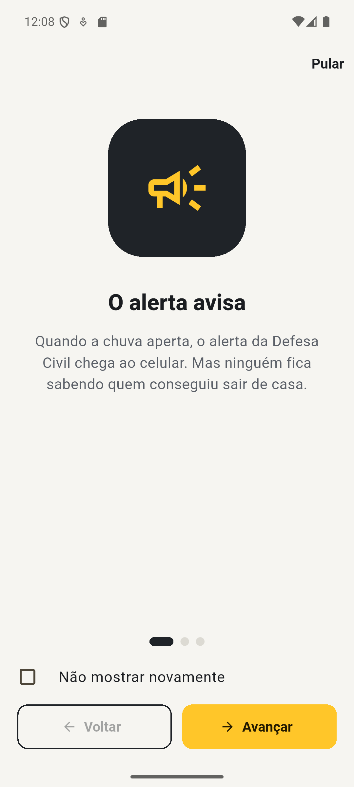 | 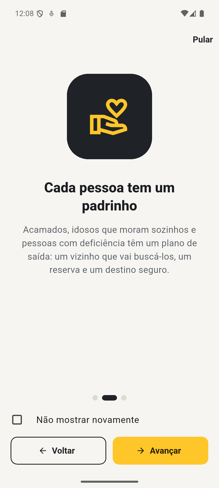 | 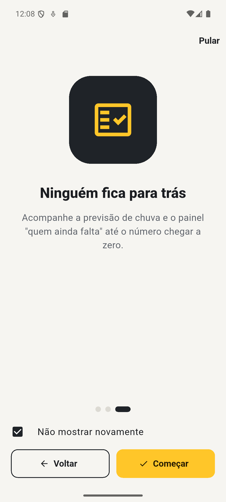 |

Na última página, "Não mostrar novamente" está marcado. Com isso, a próxima abertura vai da Splash direto para o Início.

### Tela inicial

| Início (topo) | Início (prioridades e carrossel) | Início depois de agir |
| --- | --- | --- |
|  |  | 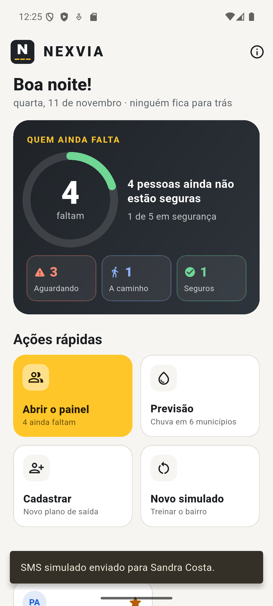 |

No terceiro print, uma pessoa já está segura e outra tem o padrinho a caminho: o anel começou a se completar e o resumo das etapas mudou.

### Painel e ciclo de uma pessoa

| Painel | Busca "encosta" + filtro "Faltam" | Detalhes |
| --- | --- | --- |
| 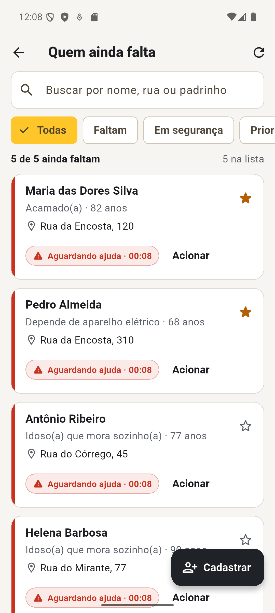 | 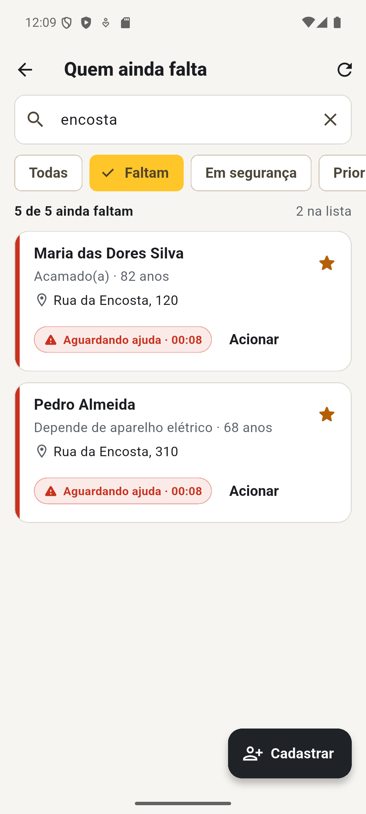 | 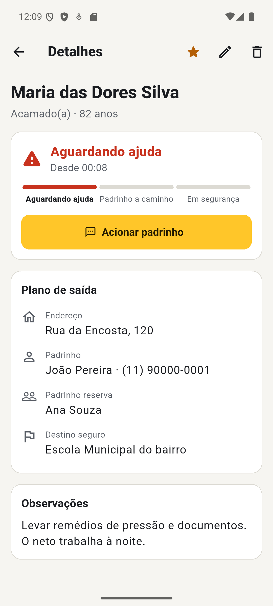 |

| Padrinho acionado (SMS simulado) | Em segurança | Painel atualizado |
| --- | --- | --- |
| 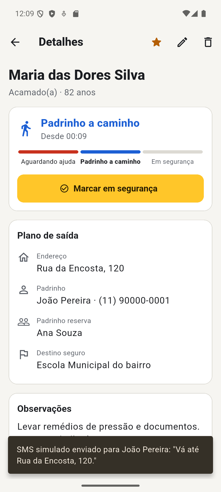 | 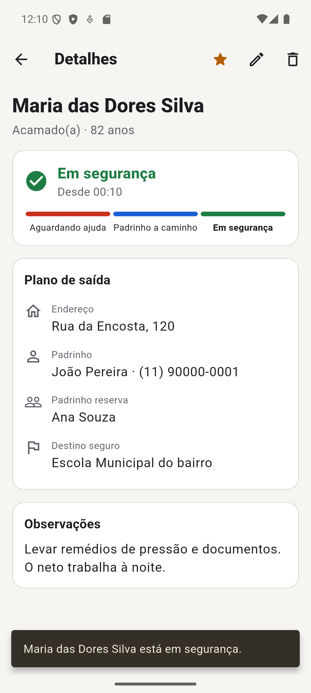 | 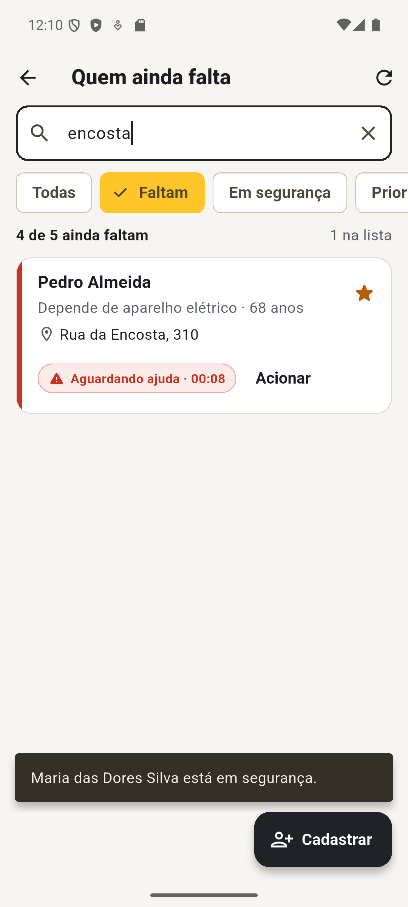 |

### Cadastro, edição e exclusão

| Cadastro preenchido | Validação | Cadastro salvo | Confirmar exclusão | Excluído |
| --- | --- | --- | --- | --- |
| 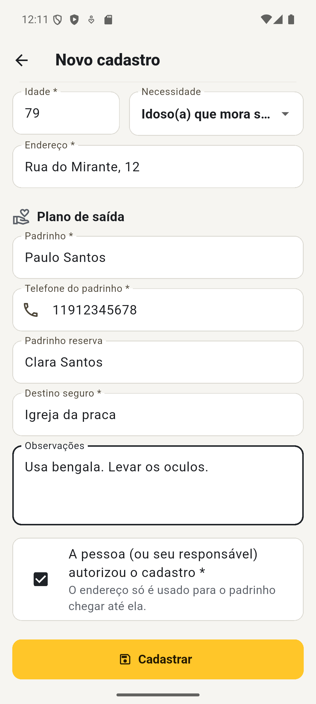 | 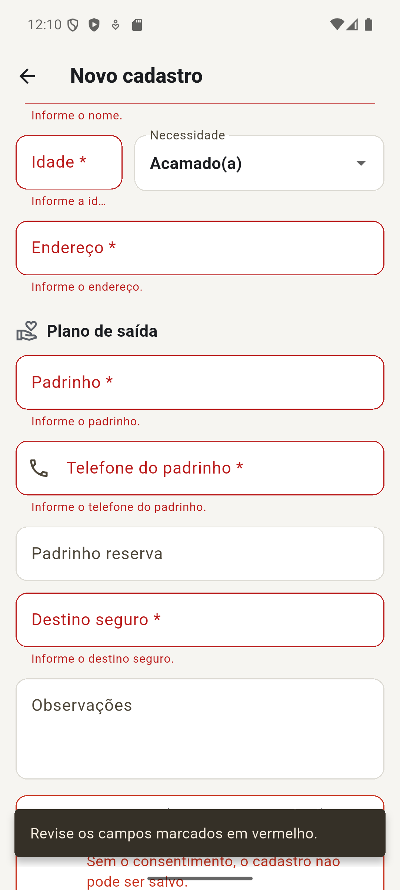 | 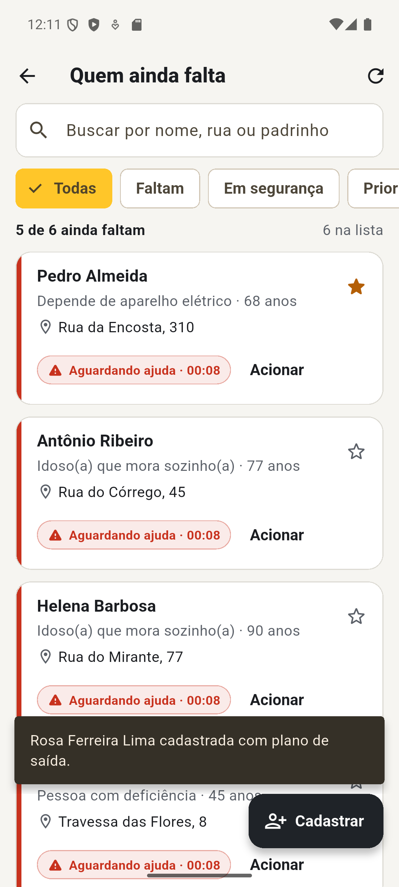 | 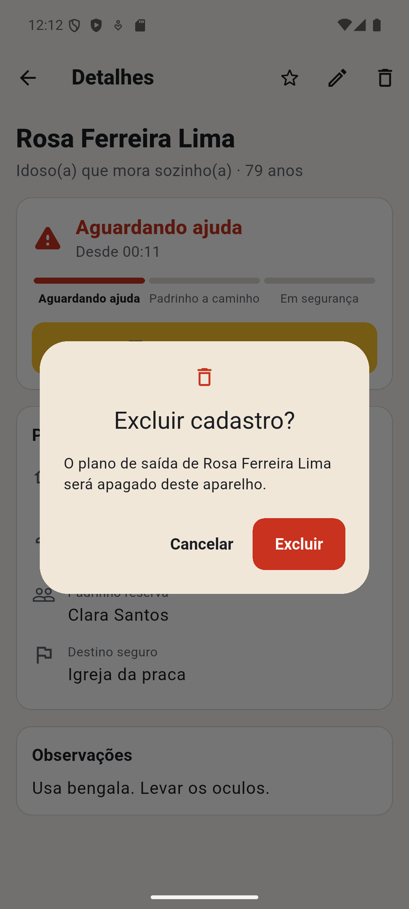 | 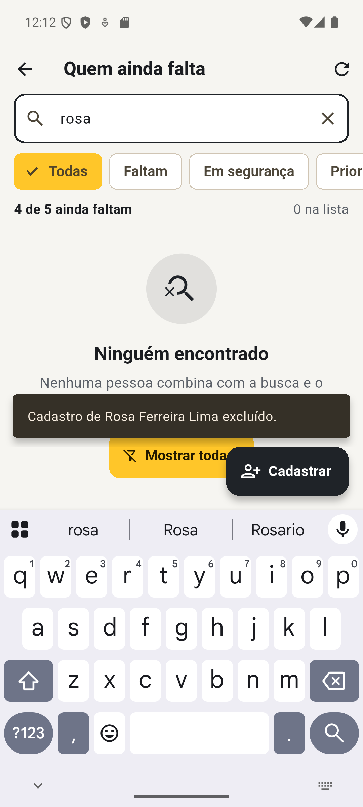 |

### Previsão de chuva (WebService)

| Inicial | Carregando | Sucesso | Busca sem acento |
| --- | --- | --- | --- |
| 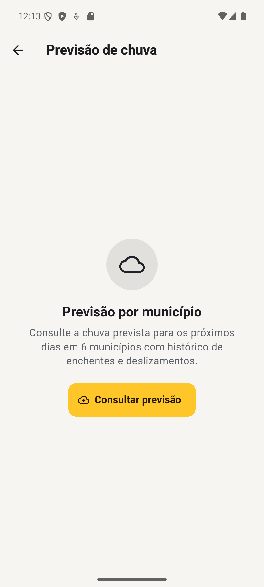 | 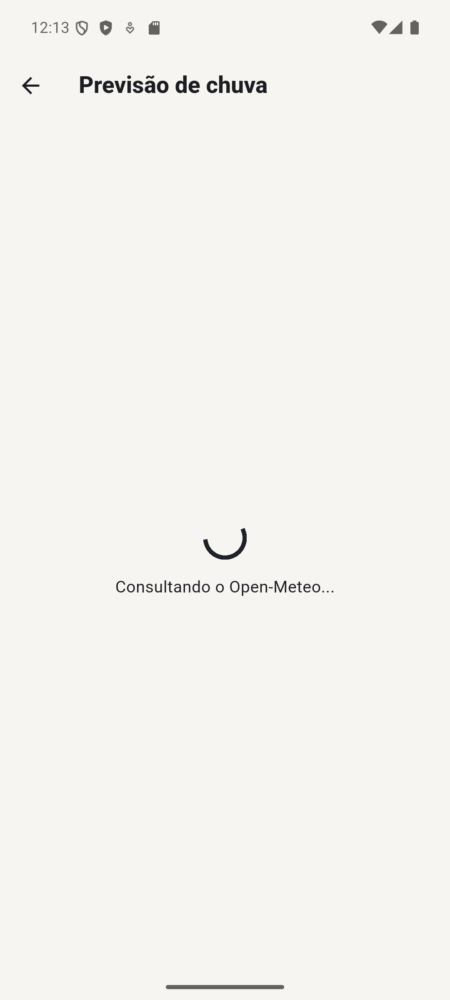 |  | 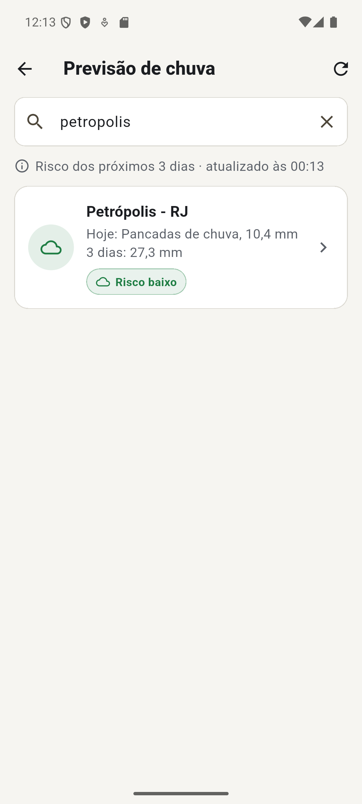 |

| Detalhe do município | Erro (modo avião) | Sobre | Dados após fechar o app |
| --- | --- | --- | --- |
| 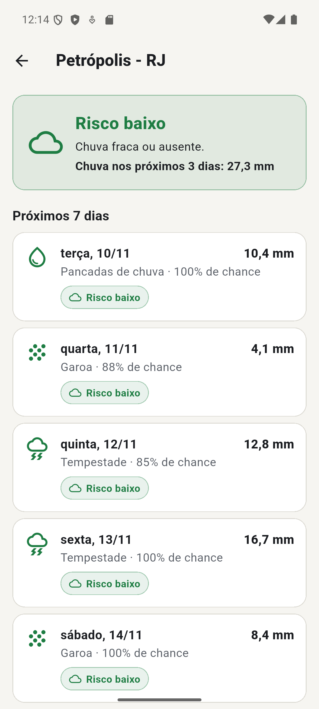 | 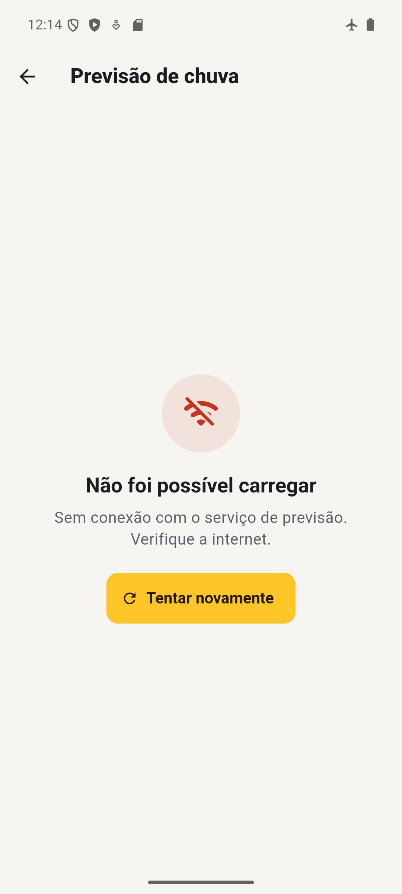 | 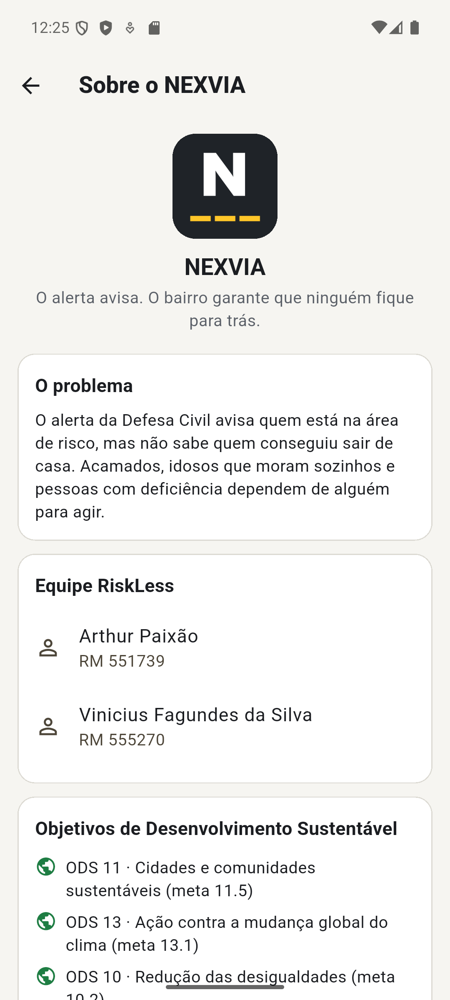 | 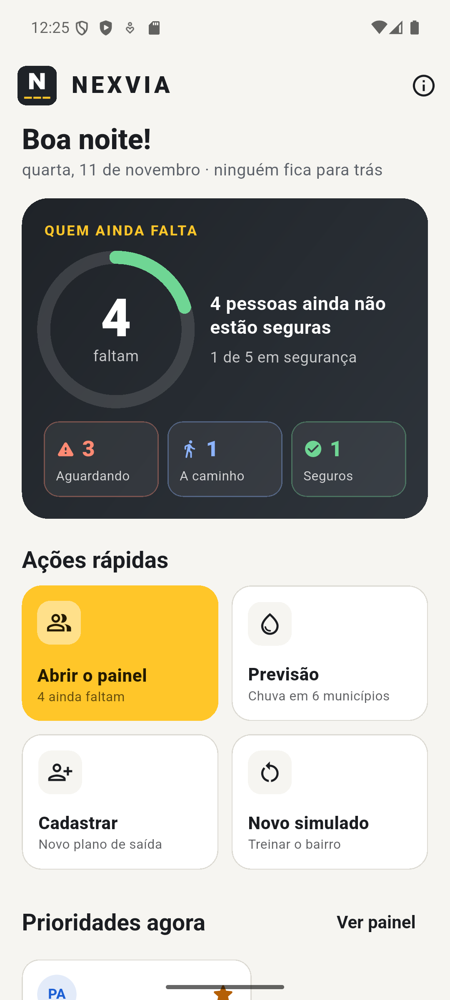 |

## API utilizada

**[Open-Meteo](https://open-meteo.com)**, uma API REST pública e gratuita que dispensa chave de acesso.

Endpoint consumido, com as coordenadas dos 6 municípios numa única requisição:

```
GET https://api.open-meteo.com/v1/forecast
    ?latitude=-21.7642,-22.505,-23.5505,-26.9194,-30.0346,-8.0476
    &longitude=-43.3503,-43.1786,-46.6333,-49.0661,-51.2177,-34.877
    &daily=precipitation_sum,precipitation_probability_max,weather_code
    &timezone=America/Sao_Paulo
    &forecast_days=7
```

Trecho da resposta, para um município:

```json
{
  "daily": {
    "time": ["2026-11-10", "2026-11-11"],
    "precipitation_sum": [10.4, 4.1],
    "precipitation_probability_max": [100, 88],
    "weather_code": [81, 51]
  }
}
```

O JSON vira objetos Dart em `PrevisaoLocal.fromJson`, que monta a lista de `PrevisaoDia`. Valores `null` da API viram 0. O risco de cada dia vem de `NivelRisco.calcular`, uma regra simplificada do protótipo que não substitui o critério oficial da Defesa Civil:

| Chuva prevista no dia | Nível |
| --- | --- |
| menos de 20 mm | Risco baixo |
| 20 mm ou mais | Atenção |
| 50 mm ou mais, com chance de 50% ou mais | Risco alto |

**Estados da tela** (enum `EstadoCarregamento`):

| Estado | O que aparece |
| --- | --- |
| Inicial | Explicação e o botão "Consultar previsão" |
| Carregando | Indicador de progresso e o texto "Consultando o Open-Meteo..." |
| Sucesso | Lista do maior para o menor risco, com busca; puxar para baixo ou tocar em ↻ atualiza |
| Erro | Mensagem clara (sem internet, demora acima de 15 s, erro do servidor ou formato inesperado) e o botão "Tentar novamente" |

## Arquitetura

```
lib/
├── main.dart                     MaterialApp, tema e tela inicial (Splash)
├── models/                       classes de dados (fromJson / toJson)
│   ├── pessoa.dart               Pessoa + StatusPessoa (ordem do fluxo)
│   ├── previsao_local.dart       PrevisaoLocal.fromJson (resposta do Open-Meteo)
│   ├── previsao_dia.dart
│   ├── nivel_risco.dart          regra de risco por chuva
│   ├── local_monitorado.dart
│   ├── filtro_painel.dart
│   ├── dica_preparo.dart         página do carrossel da tela inicial
│   └── estado_carregamento.dart  inicial / carregando / sucesso / erro
├── data/                         dados fixos: municípios, necessidades, dicas e pessoas de exemplo
├── services/                     acesso a dados e regras de negócio
│   ├── previsao_service.dart     requisição HTTP (pacote http), ordenação e busca
│   ├── preferences_service.dart  "não mostrar a introdução" (SharedPreferences)
│   ├── pessoa_repository.dart    lista de pessoas em JSON (SharedPreferences)
│   ├── pessoa_service.dart       salvar, excluir, avançar etapa, prioridade, simulado, filtro, ordem e resumos
│   └── pessoa_validator.dart     regras de validação do cadastro
├── screens/                      as 9 telas
├── widgets/                      widgets reutilizáveis
│   ├── logo_nexvia.dart          Image.asset + Hero (Splash, Início e Sobre)
│   ├── contador_card.dart        "Quem ainda falta" com anel e resumo das etapas
│   ├── anel_progresso.dart       Stack + CircularProgressIndicator animado
│   ├── atalho_card.dart          bloco da grade de ações rápidas
│   ├── prioritarias_section.dart lista horizontal das prioridades
│   ├── banner_carrossel.dart     PageView + Image.network (StatefulWidget com Timer)
│   ├── pessoa_card.dart          card do Painel
│   ├── previsao_card.dart        card da Previsão
│   ├── selo.dart                 selo de situação e de risco (cor + ícone + texto)
│   ├── mensagem_estado.dart      estados inicial, erro e lista vazia (usado em 2 telas)
│   ├── info_linha.dart, secao_card.dart, pagina_introducao.dart
│   └── status_visual.dart        cor e ícone de cada situação, risco e tempo
├── theme/                        cores e ThemeData
└── utils/formatadores.dart       hora, dia, telefone, milímetros e texto sem acento
```

**Fluxo das responsabilidades:**

```
Screen (setState) ──> Service (regras) ──> Repository / http ──> SharedPreferences / API REST
        ^                                                                   │
        └──────────────── Model (fromJson / toJson) <──────────────────────┘
```

- As **telas** só guardam o estado da interface e chamam os services. Nenhuma regra de negócio fica no `build`.
- O **`PessoaService`** concentra as regras: a ordem das etapas, quem conta como "falta", a ordenação do painel (prioritárias primeiro, seguras por último), a busca e o filtro.
- O **`PessoaValidator`** concentra as regras do formulário, e o **`PrevisaoService`** concentra a ordenação e a busca dos municípios.
- O **`PrevisaoService`** recebe o `http.Client` pelo construtor. Isso permite testá-lo com `MockClient`, sem internet.
- **Gerenciamento de estado** com `StatefulWidget` + `setState`. As telas que só exibem dados recebidos (Previsão do município e Sobre) são `StatelessWidget`, assim como os widgets de `widgets/`. A exceção é o `BannerCarrossel`, que guarda a página atual e o `Timer` da troca automática.
- **Persistência local** com `shared_preferences` (`SharedPreferencesAsync`): a escolha da introdução e a lista de pessoas, com etapa, horário e prioridade. Tudo continua salvo depois de fechar o app (print 23).

## Checklist dos requisitos

| Requisito do enunciado | Onde está |
| --- | --- |
| **1. Splash:** logo, transição automática, SharedPreferences e direcionamento | `splash_screen.dart`, `preferences_service.dart` |
| **2. Introdução:** imagem/ícone, título, descrição, voltar/avançar, 3 páginas, "Não mostrar novamente" salvo no SharedPreferences | `onboarding_screen.dart`, `pagina_introducao.dart` |
| **3. Navegação:** 4+ telas, parâmetros e retorno | 7 telas principais; `PessoaDetalheScreen(pessoa:)`, `PessoaFormScreen(pessoa:)`, `PrevisaoDetalheScreen(previsao:)`; resultados com `Navigator.pop` |
| **4. WebService:** `http`, endpoint REST, JSON → models, 4 estados, mensagens de erro, tentar novamente | `previsao_service.dart`, `previsao_local.dart`, `previsao_screen.dart` |
| **5. Componentes:** Column, Row, Card, ListView **e** GridView, Scaffold, AppBar, Elevated/Text/OutlinedButton, Icon/IconButton, Image.asset **e** Image.network | em todas as telas; `GridView` e `ListView` horizontal na tela inicial; `Image.asset` em `logo_nexvia.dart`; `Image.network` em `banner_carrossel.dart` |
| **6. Interações** (mínimo 3) | item → detalhe (Painel e Prioridades); busca (painel e previsão); filtros; favoritar (★ prioridade); avançar etapa; cadastrar, editar e excluir; puxar para atualizar; novo simulado; carrossel arrastável |
| **7. Organização e estado** | pastas `models`, `services`, `screens`, `widgets`; `setState`; regras fora das telas; widgets reutilizados |

## Como executar

Pré-requisitos: Flutter 3.38 ou mais novo (testado com o Flutter 3.47.9 e o Dart 3.13.7) e um emulador ou aparelho Android.

```bash
flutter pub get
flutter run
```

Testes automatizados (23 testes: regras do painel e da tela inicial, validação do cadastro, conversão do JSON, ordenação e busca da previsão, erros do WebService e widget do contador):

```bash
flutter test
```

Na primeira abertura, o app já vem com 5 pessoas fictícias para a demonstração. Para recomeçar o exercício, use **Novo simulado** na tela inicial.

> **Windows:** se a pasta do projeto tiver acento (ex.: "Área de Trabalho"), o build Android já está liberado em `android/gradle.properties` (`android.overridePathCheck=true`). Se a pasta estiver no OneDrive e o build falhar com "Unable to delete directory", pause a sincronização ou copie o projeto para uma pasta fora do OneDrive.

## Créditos das imagens

As fotos do carrossel são carregadas do Wikimedia Commons, com licença livre:

- [Operações de resgate em Porto Alegre, 2024](https://commons.wikimedia.org/wiki/File:IBPA_134195_-_Seguem_nesta_segunda-feira_(06),_as_opera%C3%A7%C3%B5es_de_resgate_-_2024-05-06_-_Divulga%C3%A7%C3%A3o-PMPA.jpg): Divulgação/Prefeitura de Porto Alegre (atribuição)
- [Mochila de emergência organizada](https://commons.wikimedia.org/wiki/File:Mochila_de_emergencia_organizada.jpg): Estefanych (CC BY-SA 4.0)
- [Monumento aos voluntários das enchentes de 2024](https://commons.wikimedia.org/wiki/File:Monumento_aos_volunt%C3%A1rios_das_enchentes_de_2024_em_Porto_Alegre.jpg): Otávio Astor Vaz Costa (CC0)
